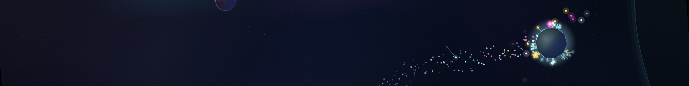

# Moonseed

*Gather stardust · land gently · grow gardens*

**[▶ Play in your browser](https://cloudy-rejko.github.io/moonseed/)** (desktop or phone, nothing to install)

Moonseed is a small, relaxing space game. You fly a little line-art ship around tiny star systems, scoop
up drifting stardust and land softly on planets and moons to plant it. Every touchdown makes a glowing
garden grow, until the whole system is in bloom and a lane of light carries you on to the next one.

There's no game over and no timer. A clumsy landing just bounces you and spills a few seeds back into
space, where you can collect them again.

## How to play

1. **Fly** through stardust to collect it as seeds.
2. **Land gently**, slowly and roughly feet-first. The ring at the end of your dotted path turns green
   when you'd land.
3. Your seeds are **planted** around you and grow into a garden.
4. When **every garden blooms**, follow the light out of the system.

| | Keyboard | Phone |
|---|---|---|
| Turn | ← → | drag anywhere |
| Thrust | ↑ | drag further |
| Gentle thrust | ↓ | |
| Brake and land | Space (hold) | a second thumb anywhere |
| Throw seeds (landed) | hold E: ← → aim, ↑ ↓ strength, let go | pull back from the ship, let go |
| Let go of a towed seed pod | E | tap the pod |
| Menu | P or Esc | ❚❚ in the corner |

WASD works too, and so does the mouse: the ship turns toward the cursor, left button to thrust,
right button for gentle thrust; landed, drag back from the ship to throw seeds.

**On an iPhone:**
- No sound? The silent switch mutes web pages too.
- Safari runs web pages at 60 fps even on a 120 Hz screen. For smoother flight, turn off **Settings → Apps
  → Safari → Advanced → Feature Flags → "Prefer Page Rendering Updates near 60fps"**.

## What's in it

- Endless generated star systems: twin planets, black holes, ringed gas giants you can dive through,
  crystal moons, trojan moons and more, each with its own colours, sky and music.
- Comets with golden trails, solar-wind currents to ride, calm clouds, asteroids to crack open, and
  pollen to ferry between gardens.
- Music made from play: every pickup and planting is a note, and every garden in bloom adds a layer.
- A star map of the systems you've passed through, and a photo mode.
- Your progress is saved in your browser.

## Tiny by design

The whole game is two files: a 2 KB `index.html` and a 331 KB `game.js`. Compressed, that's about
**107 KB**, smaller than the screenshot at the top of this page.

There are no images, no sound files, no fonts and no libraries. Every star, planet, plant and comet is
drawn by code as you play, and every sound is synthesised live by your browser: the engine's hum, the
chime of each pickup, the clunk of a landing and the music of a garden in bloom.

The gravity is real, too: a restricted n-body simulation running live in your browser. Your ship, every
mote of stardust, every comet and every asteroid is pulled by every planet and moon at once, with
inverse-square gravity worked out 120 times a second. The dotted line
ahead of you is a live simulation of where you're heading, up to half a minute into the future, with the
moons moving along their orbits as it goes. The planets and moons themselves follow fixed orbits, so a
system stays stable however long you play.

## Credits

Made by cloudy-rejko and Opus 5.5.

© 2026 cloudy-rejko. All rights reserved.

## Changelog

### 1.1 (31 October 2026)

- **Rogue planets** wander through some systems on paths of their own. Land on one and plant it, and in
  full bloom it blasts off on its flower engine: a victory lap, a loop-the-loop, and away.
- **Throw seeds** while you're landed: drag back from the ship like a slingshot (or hold E) and let go.
  Each throw is a pod carrying a tenth of your seeds that sows a stripe of ground where it lands, and any
  seeds it can't use float off as stardust.
- **Seed pods** drift through some systems. Match speed to hook one on a tether, then smash it into a
  garden and it bursts into a patch of growth.
- **Solar gusts**: the sun glows, breathes out a wave of light, and a line of sun-coloured dust follows.
  Race along the line, or gather the drifts it leaves behind the moons. Gardens in full bloom shed spores
  on the wind, and now and then one takes root elsewhere as a single flower.
- **New worlds and stars**: pairs of dwarf stars, a rare neutron star with sweeping pulsar beams,
  fast-spinning worlds, planets wrapped in thick air you can skim to slow down, and icy moons with geysers
  to ride.
- **Light traces**: fly a clean orbit hands-off and it lights up as a ring; swing close past a body for an
  arc of light.
- **Space brakes** on the keyboard, like the second thumb on a phone.
- The seeds circling your ship change colour as your hoard grows, with a word every 500 seeds.
- A new system gets a moment to itself before its info card appears.

### 1.0 (29 October 2026)

- First release.
