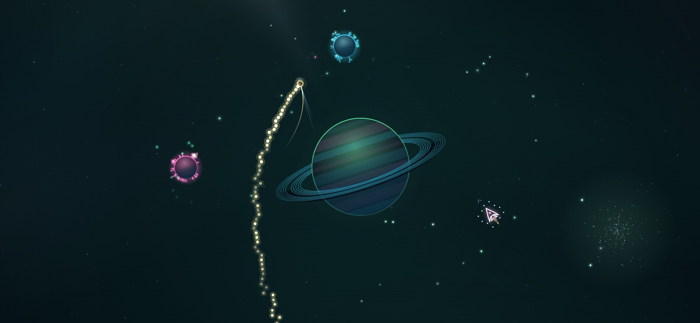
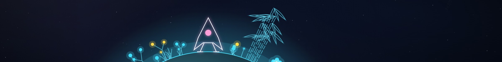
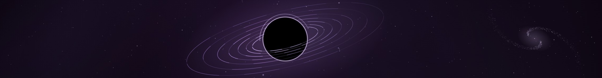

# Moonseed

*Gather stardust · land gently · grow gardens*

**[▶ Play in your browser](https://cloudy-rejko.github.io/moonseed/)** (desktop or phone, nothing to install)

Moonseed is a small, relaxing space game. You fly a little line-art ship around tiny star systems, scoop
up drifting stardust and land softly on planets and moons to plant it. Every touchdown makes a glowing
garden grow, until the whole system is in bloom and a lane of light carries you on to the next one.

There's no game over and no timer. A clumsy landing just bounces you and spills a few seeds back into
space, where you can collect them again.

## How to play

1. **Fly** through stardust to collect it as seeds.
2. **Land gently**, slowly and roughly feet-first. The ring at the end of your dotted path turns green
   when you'd land.
3. Your seeds are **planted** around you and grow into a garden.
4. When **every garden blooms**, follow the light out of the system.

| | Keyboard | Phone |
|---|---|---|
| Turn | ← → | drag anywhere |
| Thrust | ↑ | drag further |
| Gentle thrust | ↓ | |
| Brake and land | | a second thumb anywhere |
| Menu | P or Esc | ❚❚ in the corner |

WASD and Space work too, and so does the mouse: the ship turns toward the cursor, left button to thrust,
right button for gentle thrust.

**On an iPhone:**
- No sound? The silent switch mutes web pages too.
- Safari runs web pages at 60 fps even on a 120 Hz screen. For smoother flight, turn off **Settings → Apps
  → Safari → Advanced → Feature Flags → "Prefer Page Rendering Updates near 60fps"**.

## What's in it

- Endless generated star systems: twin planets, black holes, ringed gas giants you can dive through,
  crystal moons, trojan moons and more, each with its own colours, sky and music.
- Comets with golden trails, solar-wind currents to ride, calm clouds, asteroids to crack open, and
  pollen to ferry between gardens.
- Music made from play: every pickup and planting is a note, and every garden in bloom adds a layer.
- A star map of the systems you've passed through, and a photo mode.
- Your progress is saved in your browser.

## Tiny on purpose

The whole game is two files: a 2 KB `index.html` and a 171 KB `game.js`. Compressed, that's about
**54 KB**, a third of the size of the screenshot at the top of this page.

There are no images, no sound files, no fonts and no libraries. Every star, planet, plant and comet is
drawn by code as you play, and every sound is synthesised live by your browser: the engine's hum, the
chime of each pickup, the clunk of a landing and the music of a garden in bloom.

The gravity is real, too: a restricted n-body simulation running live in your browser. Your ship, every
mote of stardust, every comet and every asteroid is pulled by every planet and moon at once, with
inverse-square gravity worked out 120 times a second. The dotted line
ahead of you is a live simulation of where you're heading, up to half a minute into the future, with the
moons moving along their orbits as it goes. The planets and moons themselves follow fixed orbits, so a
system stays stable however long you play.

To run it yourself, serve the folder with any static web server.

## Credits

Made by cloudy-rejko and Opus 5.5.

© 2026 cloudy-rejko. All rights reserved.
